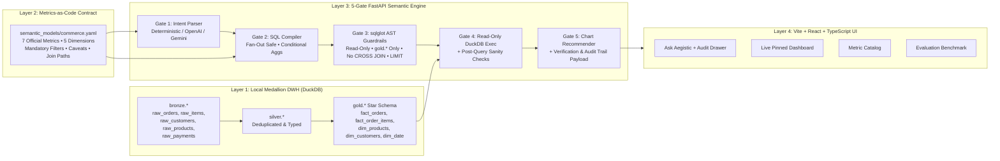

# Aegistic — Verified Self-Service BI

**Aegistic** is a desktop-first **Verified Self-Service BI** platform powered by a **Metrics-as-Code Semantic Layer (`YAML`)** and **AST SQL Guardrails (`sqlglot`)**. Instead of letting raw Text-to-SQL hallucinate metrics, fan out joins, or run unsafe queries against raw tables, every natural-language question passes through a deterministic **5-Gate Verification Pipeline** backed by a local Medallion DuckDB Data Warehouse.

> **Case Study Dataset:** *Nusantara Commerce* — deterministic 18-month Indonesian omnichannel e-commerce dataset (~50,000 deduplicated orders, ~90,000 order items, 12,000 customers, 120 products) with realistic data-quality traps in `bronze.*` and governed Star Schema tables in `gold.*`.

---

## Architecture Overview



---

## Key Capabilities

1. **Governed Semantic Layer (`semantic_models/commerce.yaml`):**
   - Locks official definitions for **7 metrics**: `net_revenue`, `gross_revenue` (GMV), `total_orders` (Completed Orders), `aov`, `gross_margin_pct`, `repeat_purchase_rate`, and `refund_rate`.
   - Locks **5 official dimensions**: `order_date` (`day`/`week`/`month`/`quarter`), `product_category`, `customer_segment`, `region`, and `payment_method`.
   - Prevents join fan-out automatically (uses item-grain expressions when slicing order metrics by `product_category`) and uses conditional aggregation so multi-metric queries with conflicting status scopes (e.g. *Net Revenue + Refund Rate per region*) execute accurately in one query.
2. **Hard AST SQL Guardrails (`sqlglot`):**
   - Blocks DDL/DML (`DROP`, `DELETE`, `UPDATE`, `INSERT`, `ALTER`, `COPY`, `ATTACH`).
   - Enforces `gold.*` schema isolation (blocks `bronze.*` and `silver.*`).
   - Rejects Cartesian `CROSS JOIN` and enforces `LIMIT <= 1000`.
   - Executes on `duckdb.connect(..., read_only=True)` with post-query sanity checks (`partial_period_check`, `missing_dates_check`, `null_ratio_check`, `empty_result_check`).
3. **Graceful Refusal & Clarification:**
   - Ambiguous prompts (e.g., *"Produk mana yang paling bagus?"*) return `clarification_required` with official metric suggestions.
   - Out-of-scope prompts (e.g., *"Berapa Employee NPS?"*, *"CAC"*, *"LTV"*) return `refused`.
   - Adversarial / SQL-injection prompts return `guardrail_blocked` with failed AST check diagnostics.
4. **4-Module Desktop-First Web Application:**
   - **Ask Aegistic:** Natural-language BI in Indonesian or English, automatic Recharts visualization, tabular data, collapsible **Verification & Audit Trail Drawer**, and one-click **Pin to Dashboard**.
   - **Live Dashboard:** Persistent SQLite-backed pinned cards with live refresh against DuckDB.
   - **Metric Catalog:** Live documentation rendered straight from `semantic_models/commerce.yaml`.
   - **Evaluation Benchmark:** Transparent comparison of **Baseline (Raw Text-to-SQL)** vs **Aegistic** across 60 golden test cases.

---

## Lightweight Local Stack

Designed for fast local startup with minimal RAM/disk footprint—**no Docker, no `dbt`, no external database servers, and no heavy ML frameworks**:

| Layer | Technology |
|---|---|
| **Data Warehouse** | DuckDB (in-process columnar OLAP, single local file `aegistic.duckdb`) + pure SQL Medallion pipeline |
| **Semantic Engine & API** | Python 3.12 (`.venv`), FastAPI, Uvicorn, Pydantic v2, PyYAML, `sqlglot`, `httpx`, `pytest` |
| **Dashboard Persistence** | Local SQLite (`semantic_engine/data/dashboards.sqlite3`) |
| **Frontend** | Vite + React + TypeScript, Tailwind CSS, Recharts, Lucide Icons |

---

## Quick Start & Setup

### Prerequisites
- **Python 3.11+** (tested on Python 3.12)
- **Node.js 18+** & **npm**

### 1. Environment & Python Dependencies

#### Windows (PowerShell)
```powershell
python -m venv .venv
.\.venv\Scripts\python.exe -m pip install --upgrade pip
.\.venv\Scripts\python.exe -m pip install -r requirements.txt
Copy-Item .env.example .env
```

#### macOS / Linux (bash/zsh)
```bash
python3 -m venv .venv
.venv/bin/python -m pip install --upgrade pip
.venv/bin/python -m pip install -r requirements.txt
cp .env.example .env
```

> **Offline-ready by default:** `.env.example` sets `AEGISTIC_PARSER_MODE=deterministic` so the entire platform works locally without external API keys. Optionally set `AEGISTIC_PARSER_MODE=openai` (with `OPENAI_API_KEY`) or `gemini` (with `GEMINI_API_KEY`).

### 2. Build the Local DuckDB Data Warehouse & Run DQ Tests

#### Windows (PowerShell)
```powershell
.\.venv\Scripts\python.exe data_warehouse/build_dwh.py
.\.venv\Scripts\pytest.exe data_warehouse/tests -v
```

#### macOS / Linux
```bash
.venv/bin/python data_warehouse/build_dwh.py
.venv/bin/pytest data_warehouse/tests -v
```

### 3. Run Semantic Engine Tests & 60-Case Evaluation Benchmark

#### Windows (PowerShell)
```powershell
.\.venv\Scripts\pytest.exe semantic_engine/tests -v
.\.venv\Scripts\python.exe evaluation/run_benchmark.py
```

#### macOS / Linux
```bash
.venv/bin/pytest semantic_engine/tests -v
.venv/bin/python evaluation/run_benchmark.py
```

### 4. Start Backend API & Frontend Dev Server

#### Terminal 1 — FastAPI Backend (`http://localhost:8000`)
```powershell
# Windows PowerShell
.\.venv\Scripts\python.exe -m uvicorn semantic_engine.app.main:app --reload --port 8000

# macOS / Linux
.venv/bin/python -m uvicorn semantic_engine.app.main:app --reload --port 8000
```

#### Terminal 2 — Vite + React Frontend (`http://localhost:5173`)
```bash
cd frontend
npm install
npm run dev
```

Open **`http://localhost:5173`** in your browser. API documentation is also available at **`http://localhost:8000/docs`**.

---

## Design System — Palette 1 Adjusted

The UI strictly enforces high-contrast WCAG AA tokens tailored for data-heavy desktop analytics (`frontend/src/styles/tokens.css`):

| UI Role | Token / Color | HEX | Usage |
|---|---|---|---|
| **Primary Brand & CTA** | Deep Indigo | `#3B498B` (Hover `#2D3870`, Tint `#EEF0FA`) | Brand mark, Ask / Pin CTAs, active navigation, input focus |
| **Data Viz & Verified Badge** | Sky Blue | `#4DA8E5` (Tint `#EBF6FD`, Text `#1B6CA8`) | Primary chart series, *"Verified by Semantic Layer"* badge |
| **Multi-Series Chart Ramp** | Indigo–Sky Scale | `#3B498B`, `#4DA8E5`, `#7685C4`, `#2A7EB5`, `#9BCBF0` | Multi-series lines & grouped bars |
| **Guardrails, Caveat & Warnings** | Crimson | `#E11D48` (Bg `#FFF1F2`, Border `#FECDD3`, Text `#9F1239`) | AST guardrail blocks, graceful refusals, partial-period warnings |
| **Canvas & Card Surface** | Pure White & Cool Tint | Canvas `#F8FAFC`, Card `#FFFFFF` | Clean analytical workspace canvas and elevated cards |
| **Surface, Border & Audit Trail** | Cool Slate Gray | Border `#CBD5E1` / `#E2E8F0`, Code Bg `#F1F5F9`, Muted `#526075` | Dividers, SQL code blocks (`JetBrains Mono`), secondary metadata |
| **Primary Text & KPI Numbers** | Dark Charcoal | Heading/KPI `#111827`, Body `#1F2937` | Headings, KPI values (`tabular-nums`), table cells |

---

## Evaluation Benchmark (60 Golden Cases)

The evaluation suite in [`evaluation/golden_dataset.json`](evaluation/golden_dataset.json) benchmarks **Baseline (Raw Text-to-SQL)** against **Aegistic (Semantic Layer + AST Guardrails)** across 60 bilingual (Indonesian & English) test cases executed against live `aegistic.duckdb`:

- **25 Standard Business Queries:** Monthly/quarterly trends, category/region/segment/payment breakdowns, filtered queries, and KPI scalars.
- **20 Definition Traps:** Join fan-out traps, conflicting multi-metric status scopes (`Net Revenue + Refund Rate`), raw `bronze.*` duplicates, shipping cost leakage, repeat buyer rank traps, and Gross Margin COGS/discount traps.
- **15 Out-of-Scope & Adversarial Prompts:** 5 ambiguous questions, 5 unregistered metrics (Employee NPS, CAC, LTV, Inventory, Churn), and 5 adversarial / DDL / DML / `bronze.*` / `CROSS JOIN` prompts.

### Live Benchmark Results (`evaluation/results/benchmark_report.json`)

| Metric | Baseline (Raw Text-to-SQL) | Aegistic (5-Gate Engine) |
|---|---:|---:|
| **Execution Accuracy** *(45 analytical cases)* | 40.0% | **100.0%** |
| **Hallucination / Definition Error Rate** | 60.0% | **0.0%** |
| **Safe Refusal Rate** *(15 OOS & adversarial cases)* | 13.3% | **100.0%** |
| **Overall Pass Rate** *(60 cases)* | 33.3% | **100.0%** |
| **Median Query Latency** | 28.0 ms | **31.2 ms** |

| Category | Total Cases | Baseline Passed | Aegistic Passed |
|---|---:|---:|---:|
| **Standard Business Queries** | 25 | 18 / 25 (72.0%) | **25 / 25 (100.0%)** |
| **Definition Traps** | 20 | 0 / 20 (0.0%) | **20 / 20 (100.0%)** |
| **Out-of-Scope & Adversarial** | 15 | 2 / 15 (13.3%) | **15 / 15 (100.0%)** |

Re-run anytime via `.\.venv\Scripts\python.exe evaluation/run_benchmark.py` (or `.venv/bin/python evaluation/run_benchmark.py`).

---

## Repository Structure

```text
aegistic/
├── aegistic_mvp_specification.md   # Product & technical specification
├── docs/api_contract.md            # Locked REST API & JSON schemas
├── requirements.txt                # Minimal local Python dependencies
├── data_warehouse/                 # Layer 1: Medallion DuckDB DWH + DQ tests
├── semantic_models/commerce.yaml   # Layer 2: Metrics-as-Code YAML contract
├── semantic_engine/                # Layer 3: 5-Gate FastAPI engine + unit tests
├── evaluation/                     # Layer 4: 60-case golden dataset & benchmark runner
└── frontend/                       # Layer 5: Vite + React + TypeScript desktop UI
```
